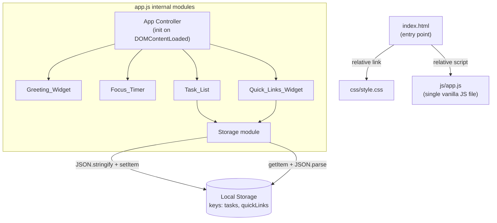
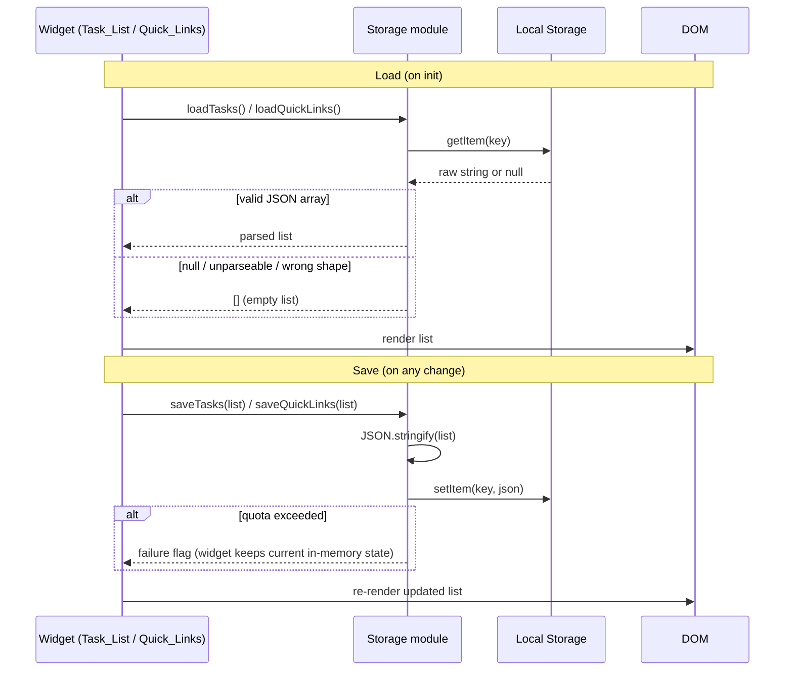
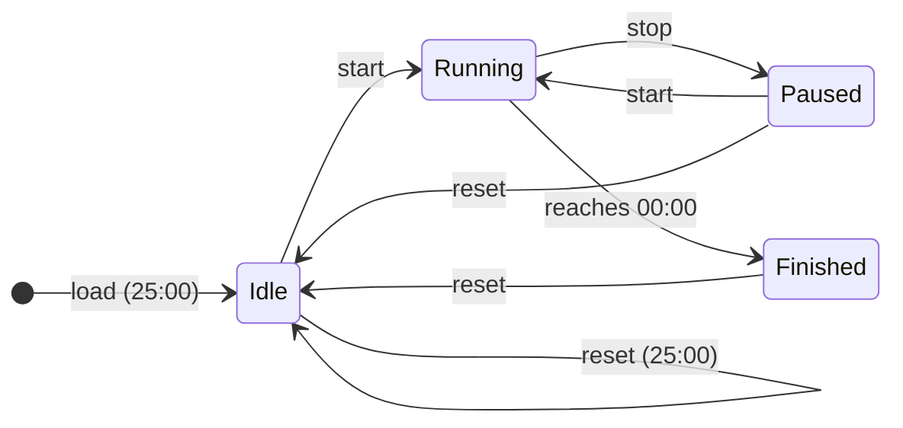

# Design Document

## Overview

The Personal Dashboard is a single-page, client-side web application that helps one user manage daily productivity. It aggregates four widgets onto one page: a Greeting_Widget (current time, date, and a time-based greeting), a Focus_Timer (a 25-minute countdown with start, stop, and reset), a Task_List (add, edit, mark done, delete), and a Quick_Links_Widget (buttons that open favorite websites, with add and remove). All persistent data lives in browser Local Storage, so the app runs with no backend server and deploys through GitHub Pages or as a browser extension.

### Design Goals

- **Zero backend, zero framework**: One HTML entry point loads one CSS file and one vanilla JavaScript file. No build step, no bundler, no frontend framework, no network requests, no cookies.
- **Correctness over cleverness**: Each widget is a small, self-contained unit with explicit state. Pure logic (time formatting, greeting mapping, task/link validation, serialization) is isolated from DOM rendering so it can be reasoned about and tested independently.
- **Persistence that survives corruption**: Reads from Local Storage never break the page. Missing, `null`, or unparseable data falls back to an empty list.
- **Accurate timing**: The Focus Timer does not rely on `setInterval` counting; it computes remaining time from wall-clock timestamps to avoid drift over a 25-minute session.
- **Same code, two contexts**: The same three files render identically as a standalone web app and as a browser extension page; only a packaging `manifest.json` is added for the extension case.

### Key Design Decisions and Rationale

| Decision | Rationale |
|----------|-----------|
| Organize `app.js` into internal modules (namespace object), not separate files | Requirement 16 mandates exactly one JS file. A single namespaced object keeps the code organized without violating the file-count constraint. |
| Storage module centralizes all Local Storage access | One place handles JSON serialization, the distinct keys for Tasks vs Quick Links, fallback on corrupt data, and `QuotaExceededError`. Widgets never call `localStorage` directly. |
| Focus Timer stores an end-timestamp, not a decrementing counter | `setInterval` drifts; recomputing remaining time from `Date.now()` each tick keeps a 25-minute countdown accurate. |
| Greeting_Widget re-reads `new Date()` every second | Wall-clock reads have no drift, so date and greeting automatically update at midnight and greeting boundaries within the one-second update cadence. |
| Task_List and Quick_Links re-render their full list on change | Simplest vanilla approach; avoids stale DOM references when items are added, edited, or deleted. Each item carries a stable `id` so edit and delete target the right item. |
| Stable generated `id` per Task and Quick Link | Required for reliable in-place edit and delete targeting when re-rendering. The `id` is internal; the round-trip contract preserves the user-visible fields (text/name, URL, done, order). |
| `manifest.json` at repo root for extension packaging | It is packaging metadata, not CSS or JS, so it does not violate the "exactly one CSS file / exactly one JS file" rule. The same `index.html`/`app.js`/`style.css` are reused. |

### Out of Scope

- No backend, accounts, authentication, or cloud sync.
- No multi-user support; the Dashboard serves a single user on a single browser profile.
- No task categories, priorities, due dates, or subtasks.
- No quick-link URL validation beyond non-emptiness (no scheme or reachability checks).
- No theming or settings beyond the fixed visual design.

## Architecture

The application is a static, single-page client app. `index.html` is the only entry point. It loads `css/style.css` and `js/app.js` through relative paths so the same files work on GitHub Pages and as an extension. All runtime logic lives in `app.js`, organized into internal modules that share a single Storage module for persistence.



### Initialization Flow

1. Browser loads `index.html`, which parses `css/style.css` (blocking, in `<head>`) and `js/app.js` (deferred, at end of `<body>`).
2. `app.js` waits for `DOMContentLoaded`, then the App Controller calls `init()` on each widget, passing its root DOM container.
3. `Task_List` and `Quick_Links_Widget` ask the Storage module to load their persisted data and render it.
4. `Greeting_Widget` renders immediately and starts a one-second tick. `Focus_Timer` initializes to 25:00, idle.
5. All four widgets are visible; Requirement 14.1 (display within one second) is met because there is no network or build step.

### Persistence Flow



### Focus Timer State Machine

The timer has three runtime states. Control enable/disable rules (Requirements 4.4, 4.5) are derived directly from state.



State → control rules:

| State | start | stop | reset | Displayed time |
|-------|-------|------|-------|----------------|
| Idle | enabled (begins from 25:00) | disabled | enabled | 25:00, static |
| Running | disabled | enabled (pauses) | enabled (resets to 25:00, stops) | counting down, MM:SS |
| Paused | enabled (resumes from displayed) | disabled | enabled (resets to 25:00) | frozen remaining |
| Finished | enabled (begins from 00:00) | disabled | enabled (resets to 25:00) | 00:00, "session ended" message shown |

## Components and Interfaces

All components are plain objects/functions inside `app.js`. Each widget owns its DOM container, its internal state, and its event handlers. The Storage module is the only component that touches `localStorage`.

### Shared: Storage Module

**Responsibility**: Read and write the two persisted collections through Local Storage, isolating serialization, key naming, fallback, and quota handling from the widgets.

**Interface**:
- `loadTasks()` → `Task[]` — returns persisted tasks, or `[]` if missing/corrupt.
- `saveTasks(tasks)` → `boolean` — serializes and writes; returns `false` on quota failure without throwing.
- `loadQuickLinks()` → `QuickLink[]` — returns persisted links, or `[]` if missing/corrupt.
- `saveQuickLinks(links)` → `boolean` — serializes and writes; returns `false` on quota failure.

**Constants**:
- `KEYS.TASKS = "personalDashboard.tasks"`
- `KEYS.QUICK_LINKS = "personalDashboard.quickLinks"`

The two keys are distinct (Requirement 12.3). Each load does `getItem` → if `null`, return `[]`; otherwise `JSON.parse` inside `try/catch`, and if the result is not an array or any element fails shape validation, return `[]` (Requirements 9.5, 11.5). Each save does `JSON.stringify` then `setItem` inside `try/catch` to absorb `QuotaExceededError`.

### Greeting_Widget

**Responsibility**: Display the current local time (12-hour, HH:MM:SS with AM/PM), the current date (day of week, full month, numeric day, four-digit year), and a time-appropriate greeting. Update at least once per second.

**State**: A single `setInterval` handle ticking every 1000 ms; no cached time value (it reads `new Date()` each tick).

**DOM structure**: A container with three child elements — time, date, greeting — each updated by text content on every tick.

**Behavior**:
- Time: convert 24-hour hour `h` to 12-hour `h12 = h % 12 || 12`, zero-pad minutes and seconds to two digits, append `AM` if `h < 12` else `PM` (Requirement 1.1).
- Date: format via `Date` methods or `Intl.DateTimeFormat` with weekday, long month, numeric day, numeric four-digit year (Requirement 1.2).
- Greeting: hour-based mapping (all boundaries fall on whole hours, so an hour check is exact):

| Condition (hour `h`) | Greeting | Requirement |
|----------------------|----------|-------------|
| `5 <= h <= 11` | "Good morning" | 2.1 |
| `12 <= h <= 16` | "Good afternoon" | 2.2 |
| `17 <= h <= 20` | "Good evening" | 2.3 |
| `h >= 21` or `h <= 4` | "Good night" | 2.4 |

Because the widget re-reads the wall clock each second, the date updates at midnight and the greeting updates at each boundary within one second (Requirements 1.3, 2.5).

### Focus_Timer

**Responsibility**: Run a 25-minute countdown with start, stop, and reset, displaying remaining time in MM:SS, stopping cleanly at 00:00, and showing a "session ended" message.

**State**:
- `remainingMs` — remaining milliseconds (source of truth while Idle/Paused/Finished).
- `endTimestamp` — wall-clock ms at which the running timer hits zero; set on start/resume.
- `intervalId` — the active `setInterval` handle, or `null` when not running.
- `status` — `Idle` | `Running` | `Paused` | `Finished`.

**Drift compensation**: On start/resume, `endTimestamp = Date.now() + remainingMs`. The 1000 ms tick recomputes `remainingMs = max(0, endTimestamp - Date.now())` and displays `Math.ceil(remainingMs / 1000)` seconds in MM:SS. This keeps the countdown accurate even if ticks fire late.

**Controls and transitions** (map to Requirements 4.1–4.5):
- **start**: if `Idle` or `Paused`, set `status = Running`, compute `endTimestamp`, start the interval. Disable start, enable stop and reset (4.4).
- **stop**: if `Running`, freeze `remainingMs` from the last tick, clear the interval, `status = Paused`. Enable start, disable stop, enable reset (4.5).
- **reset**: clear the interval, set `remainingMs = 25:00`, `status = Idle`, hide the "session ended" message. Enable start, disable stop, enable reset.
- **reaching 00:00**: on the tick where `remainingMs <= 0`, set display to 00:00, clear the interval, `status = Finished`, show the "session ended" message. Enable start, disable stop, enable reset.

**Initialization**: `remainingMs = 25 * 60 * 1000`, `status = Idle` (Requirement 3.1). While running, the display decrements one second per second (3.2) and shows MM:SS (3.3). At zero it stops and stays at 00:00 (3.4) and shows the end message (3.5).

### Task_List

**Responsibility**: Manage a list of Tasks with add, edit, toggle-done, and delete, persisting every change and rendering the result.

**State**: `tasks: Task[]` (in-memory source of truth), loaded from Storage on init. Each Task has a stable generated `id`.

**DOM structure**: A container holding the `Task_Entry` input (with submit affordance), a list element, and per-item rows. Each row renders the text (strikethrough when done), a toggle (checkbox/control), an edit control, a delete control, and an in-place edit affordance (input + save/cancel) shown only while editing that row.

**Events**:
- **Submit** (Enter or add button): read entry value, `trim()`. If the trimmed value is non-empty, append a new Task `{ id: gen(), text: trimmed, done: false }` to the end of `tasks` (5.1, 5.3), clear the entry (5.4), save and re-render. If empty, reject and keep state (5.2).
- **Toggle done**: flip `done` for the targeted Task (7.1), save and re-render. Done tasks render with strikethrough (7.2).
- **Edit**: switch the targeted row into edit mode, pre-filled with the current text, preserving position (6.1).
  - **Save**: if the edited text has at least one non-whitespace character, update the Task text (trimmed) and preserve `done` (6.2); else reject and keep the previous text (6.3).
  - **Cancel**: Escape key or cancel control discards the edit and keeps the previous text (6.4).
- **Delete**: remove the targeted Task from `tasks` (8.1), save (8.2), re-render. Deleted tasks do not reappear after reload (8.3).

**Persistence**: Every mutation (add, edit-save, toggle, delete) calls `saveTasks(tasks)` and re-renders (Requirement 9.1).

### Quick_Links_Widget

**Responsibility**: Render one button per saved Quick Link, open the URL in a new tab on activation, and support add and remove with persistence.

**State**: `links: QuickLink[]` (in-memory source of truth), loaded from Storage on init.

**DOM structure**: A container with an add control (two inputs — display name and URL — plus an add button), and a button bar. Each Quick Link renders exactly one button labeled with its display name, plus a remove control.

**Events**:
- **Add**: on submit, if display name and URL are both non-empty (non-whitespace), append `{ id: gen(), name: trimmedName, url: trimmedUrl }`, save, and render one button for it (10.4); else reject and add nothing (10.5).
- **Activate button**: open `url` in a new tab (`window.open(url, "_blank", "noopener")`) (10.2). The button label is the display name (10.3).
- **Remove**: remove the targeted Quick Link, delete its button, save (11.1).

**Rendering rule**: exactly one button per Quick Link (10.1). Re-render the button bar on add/remove.

## Data Models

### Task

| Field | Type | Notes |
|-------|------|-------|
| `id` | string | Stable, generated; used to target edit/delete on re-render. Internal; not part of the user-visible round-trip contract. |
| `text` | string | The trimmed task description. Non-empty (at least one non-whitespace character). |
| `done` | boolean | `true` when completed. `false` when added. |

Order is implied by array position in `tasks[]` and preserved on save/load.

Serialized form stored under `KEYS.TASKS`:
```json
[
  { "id": "t1", "text": "Review PR", "done": false },
  { "id": "t2", "text": "Write notes", "done": true }
]
```

### QuickLink

| Field | Type | Notes |
|-------|------|-------|
| `id` | string | Stable, generated; used to target remove on re-render. Internal. |
| `name` | string | Display name shown on the button. Non-empty (non-whitespace). |
| `url` | string | URL opened in a new tab. Non-empty (non-whitespace). |

Order is implied by array position in `links[]` and preserved on save/load.

Serialized form stored under `KEYS.QUICK_LINKS`:
```json
[
  { "id": "q1", "name": "GitHub", "url": "https://github.com" },
  { "id": "q2", "name": "MDN", "url": "https://developer.mozilla.org" }
]
```

### Local Storage Key Naming

| Key constant | Key string | Stored value |
|--------------|-----------|--------------|
| `KEYS.TASKS` | `personalDashboard.tasks` | JSON array of Task objects |
| `KEYS.QUICK_LINKS` | `personalDashboard.quickLinks` | JSON array of QuickLink objects |

The keys are distinct strings (Requirement 12.3). No other Local Storage keys are used by the Dashboard. All persistence is client-side only — no backend, network requests, or cookies (Requirement 12.1, 12.2).

### Serialization and Round-Trip

Save: `JSON.stringify(list)` → `setItem(key, json)`.
Load: `getItem(key)` → if `null`, return `[]`; else `JSON.parse` in `try/catch`; validate the result is an array of objects with the expected fields; otherwise return `[]`.

Round-trip contract (Requirements 9.4, 11.4): for any saved list, reloading restores a list with the same user-visible fields in the same order. Tasks: same `text`, same `done`, same order. Quick Links: same `name`, same `url`, same order.

### Requirements to Component Traceability

| Requirement | Owning component(s) |
|-------------|----------------------|
| 1. Greeting Time and Date Display | Greeting_Widget |
| 2. Time-Based Greeting | Greeting_Widget |
| 3. Focus Timer Countdown | Focus_Timer |
| 4. Focus Timer Controls | Focus_Timer |
| 5. Add Tasks | Task_List |
| 6. Edit Tasks | Task_List |
| 7. Mark Tasks as Done | Task_List |
| 8. Delete Tasks | Task_List, Storage |
| 9. Task List Persistence | Task_List, Storage |
| 10. Quick Links Display and Navigation | Quick_Links_Widget |
| 11. Quick Links Persistence | Quick_Links_Widget, Storage |
| 12. Client-Side Data Storage | Storage |
| 13. Browser Compatibility | All (shared web APIs), manifest.json for extension |
| 14. Performance | All (no network/build), Storage (synchronous, fast) |
| 15. Visual Design | css/style.css (layout), all widgets (semantic markup) |
| 16. File Organization | index.html, css/style.css, js/app.js |
| 17. Deployment via GitHub Pages | index.html (relative paths) |

## Correctness Properties


*A property is a characteristic or behavior that should hold true across all valid executions of a system-essentially, a formal statement about what the system should do. Properties serve as the bridge between human-readable specifications and machine-verifiable correctness guarantees.*

The properties below cover the pure-logic layer of the Dashboard: time/date formatting, the greeting mapping, the timer's drift-compensated computation and state machine, task and quick-link validation/mutation, and the two serialization round-trips. UI layout, performance timing, file organization, and deployment are not property-testable and are covered in Testing Strategy with example, integration, and smoke tests.

### Property 1: 12-hour time formatting

*For any* `Date` instant, formatting it to local 12-hour time SHALL produce a string of the form `HH:MM:SS AM` or `HH:MM:SS PM` where the hour is in 1–12 (midnight maps to 12 AM, noon to 12 PM), minutes and seconds are zero-padded to two digits, and the AM/PM indicator is `AM` before noon and `PM` from noon onward.

**Validates: Requirements 1.1**

### Property 2: Date formatting completeness

*For any* `Date` instant, formatting it to a local date string SHALL produce output containing the full weekday name, the full month name, the numeric day, and the four-digit year, each matching that date's actual weekday, month, day, and year.

**Validates: Requirements 1.2**

### Property 3: Greeting mapping is total and matches the spec table

*For any* hour `h` in 0–23, the greeting function SHALL return exactly one of "Good morning", "Good afternoon", "Good evening", or "Good night", and SHALL return the value specified by the boundary table: morning for 5–11, afternoon for 12–16, evening for 17–20, and night for 21–23 or 0–4.

**Validates: Requirements 2.1, 2.2, 2.3, 2.4**

### Property 4: Timer remaining decreases with elapsed time and never goes negative

*For any* initial remaining time and any elapsed wall-clock duration, the remaining time SHALL equal the initial remaining minus the elapsed, clamped so it never goes below zero, and once the elapsed reaches or exceeds the initial remaining the remaining SHALL stay at zero across all further ticks until reset.

**Validates: Requirements 3.2, 3.4**

### Property 5: Timer display is zero-padded MM:SS

*For any* remaining-seconds value in 0–1500, formatting it for display SHALL produce a zero-padded `MM:SS` string whose minutes equal `floor(s/60)` and whose seconds equal `s mod 60`.

**Validates: Requirements 3.3**

### Property 6: Timer control enable/disable is a pure function of status

*For any* timer status, the start control SHALL be enabled if and only if the timer is not running, the stop control SHALL be enabled if and only if the timer is running, and the reset control SHALL always be enabled.

**Validates: Requirements 4.4, 4.5**

### Property 7: Timer state transitions preserve the countdown contract

*For any* timer status, activating start from Idle or Paused SHALL set the status to Running and preserve the currently displayed remaining time; activating stop from Running SHALL set the status to Paused and preserve the remaining time; and activating reset from any status SHALL set the status to Idle, restore the remaining time to 25:00, and stop the countdown.

**Validates: Requirements 4.1, 4.2, 4.3**

### Property 8: Task add contract

*For any* task list and any input string, if the trimmed string contains at least one non-whitespace character then appending SHALL grow the list by exactly one, with the new task at the end holding the trimmed text and a completion status of not done, and the entry SHALL be cleared; if the trimmed string is empty then appending SHALL be rejected and the list and entry SHALL be unchanged.

**Validates: Requirements 5.1, 5.2, 5.3, 5.4**

### Property 9: Task edit contract

*For any* task list and any task, entering edit mode SHALL preserve the list length, order, and existing texts and start the edit buffer at that task's current text; saving with text containing at least one non-whitespace character SHALL update only that task's text to the trimmed value and preserve its completion status and position; saving with empty or whitespace-only text, or canceling via the cancel control or Escape key, SHALL keep the previous text unchanged.

**Validates: Requirements 6.1, 6.2, 6.3, 6.4**

### Property 10: Task completion toggle is an involution

*For any* task, toggling its completion SHALL flip its done status, and toggling it twice SHALL return the task to its original text and done status, so that `toggle(toggle(task))` equals `task`.

**Validates: Requirements 7.1**

### Property 11: Task delete removes exactly the targeted task

*For any* task list and any task in it, deleting that task SHALL remove exactly that task, reduce the list length by one, and leave every other task's text, completion status, and relative order unchanged.

**Validates: Requirements 8.1**

### Property 12: Task serialization round-trip

*For any* task list, saving it to Local Storage and then loading it SHALL restore a list whose tasks have the same text, the same completion status, and the same order as the saved list, and after a delete the saved-then-loaded list SHALL exclude the deleted task.

**Validates: Requirements 8.2, 8.3, 9.1, 9.2, 9.4**

### Property 13: Invalid or missing task storage loads empty

*For any* value in the tasks Local Storage key that is `null`, not parseable as JSON, not an array, or whose elements do not have the Task shape, loading SHALL return an empty list without throwing.

**Validates: Requirements 9.3, 9.5**

### Property 14: Quick Links render one button each labeled with the display name

*For any* quick-link list, rendering SHALL produce exactly one button per link, no more and no fewer, and each button's label SHALL equal that link's display name.

**Validates: Requirements 10.1, 10.3**

### Property 15: Quick Link add contract

*For any* quick-link list and any submitted display name and URL, if both are non-empty after trimming then appending SHALL grow the list by exactly one with the submitted (trimmed) name and URL; if either is empty after trimming then appending SHALL be rejected and the list SHALL be unchanged.

**Validates: Requirements 10.4, 10.5**

### Property 16: Quick Link remove removes exactly the targeted link

*For any* quick-link list and any link in it, removing that link SHALL reduce the list length by one, remove its button, and leave every other link's name, URL, and relative order unchanged.

**Validates: Requirements 10.6**

### Property 17: Quick Link serialization round-trip

*For any* quick-link list, saving it to Local Storage and then loading it SHALL restore a list whose links have the same display name, the same URL, and the same order as the saved list.

**Validates: Requirements 11.1, 11.2, 11.4**

### Property 18: Invalid or missing Quick Link storage loads empty

*For any* value in the quick-links Local Storage key that is `null`, not parseable as JSON, not an array, or whose elements do not have the Quick Link shape, loading SHALL return an empty list without throwing and without preventing the other widgets from loading.

**Validates: Requirements 11.3, 11.5**

## Error Handling

The Dashboard is a single user's local tool, so error handling favors graceful degradation: the page always loads, persisted data is never trusted blindly, and no failure in one widget should stop the others.

### Storage errors

- **Missing key** (`getItem` returns `null`): treated as an empty collection; the widget renders an empty list (Requirements 9.3, 11.3).
- **Unparseable JSON** (`JSON.parse` throws): caught, treated as an empty collection (Requirements 9.5, 11.5).
- **Wrong shape** (parsed value is not an array, or an element lacks the required fields): treated as an empty collection (Requirements 9.5, 11.5).
- **Quota exceeded** (`setItem` throws `QuotaExceededError`): caught; the write is reported as failed and the widget retains its current in-memory list so the user's current session is not lost. No exception escapes to the UI.
- **Isolation**: each widget loads its own collection independently inside its own `try/catch`, so corrupt Quick Link data does not prevent the Greeting, Focus Timer, or Task List from initializing (Requirement 11.5).

### Focus Timer errors and races

- The remaining time is clamped with `max(0, …)`, so ticks can never drive the display negative (Requirement 3.4).
- The interval handle is cleared on stop, reset, and finish, and the tick callback checks the current status before acting, so a late tick that fires after a transition does not corrupt state.
- Starting from the 00:00 (Finished) state is spec-faithful: the countdown begins from the displayed 00:00 and immediately completes, remaining at 00:00 with the "session ended" message shown. Reset is the intended way to start a fresh session.

### Task and Quick Link input errors

- Whitespace-only submissions (add or edit) are rejected and the prior state is kept; the entry is not cleared on rejection (Requirements 5.2, 6.3, 10.5).
- A canceled edit (cancel control or Escape) discards pending changes and restores the previous text (Requirement 6.4).
- Quick Link URLs are not validated for scheme or reachability; only non-emptiness is enforced (Requirement 10.4/10.5). `window.open` is called with `noopener` for safety.

### General robustness

- Each widget's `init` is wrapped so an unexpected error in one widget is logged to the console but does not block the others.
- The code uses only standard Web Storage, Date, Timer, and DOM APIs supported by all Modern Browsers, with no vendor-prefixed properties, to avoid browser-specific failures (Requirement 13.1).

## Testing Strategy

A dual approach is used: property-based tests for the pure-logic layer, and example, integration, and smoke tests for UI, timing, file organization, and deployment. The pure logic is kept in plain functions that take values and return values (formatting, greeting mapping, timer computation, task/link mutation, serialization) so it can be exercised independently of the DOM and Local Storage.

### Property-based tests (pure-logic layer)

Property-based testing is appropriate here because the formatting, mapping, validation, mutation, and serialization logic are pure functions with large input spaces where universal properties hold and 100+ iterations find more edge cases than a few examples.

- **Library**: `fast-check` (JavaScript property-based testing).
- **Iterations**: at least 100 per property test.
- **Tagging**: each test is tagged with a comment referencing the design property, in the form `Feature: personal-dashboard, Property {n}: {property text}`.
- **Isolation**: tests call the pure functions directly; the DOM and Local Storage are mocked or the round-trip functions are run against an in-memory map standing in for `localStorage`, so 100+ iterations stay fast and side-effect-free.
- **Coverage**: one property-based test per Correctness Property (Properties 1–18).

### Example-based tests (specific behavior, UI, edge cases)

These cover behavior that is not a universal pure property:

- Timer initializes to 25:00 (Requirement 3.1).
- A visible "session ended" message appears when the timer reaches zero (Requirement 3.5).
- Done tasks render with strikethrough text decoration (Requirement 7.2).
- The displayed date updates across midnight and the greeting updates across a boundary within one tick, using a fake/injected clock (Requirements 1.3, 2.5).
- Visual design: only the four widgets are present, at least 16px spacing between adjacent widgets, minimum 16px font size, and at least 4.5:1 text contrast (Requirements 15.1–15.4).

### Integration tests (external behavior, wiring, timing)

- Quick Link activation calls `window.open(url, "_blank", "noopener")` (Requirement 10.2), verified with a mocked `window.open`.
- Task and Quick Link round-trips run against a real (or `jsdom`) `localStorage` end-to-end, including reload-after-delete (Requirements 8.3, 9.4, 11.4).
- Performance: all widgets display within one second of load (Requirement 14.1), and task/quick-link mutations reflect within 100ms (Requirement 14.2).
- Extension parity: the same app loads in a browser extension context with the same features, persistence, and rendering (Requirement 13.2).
- GitHub Pages: after deploy, the app loads from the repository root with no build step and all widgets work (Requirements 17.1, 17.3).

### Smoke and static checks (configuration, structure)

- All persistent data uses Local Storage only, with no backend, network requests, or cookies, and Tasks and Quick Links use two distinct keys (Requirements 12.1–12.3).
- File organization: exactly one `css/style.css` in a `css` directory, exactly one `js/app.js` in a `js` directory, no frontend frameworks, and a single `index.html` entry point loading both via relative paths (Requirements 16.1–16.4, 17.2).
- No vendor-prefixed CSS/JS and only standard web APIs are used (Requirement 13.1).

### Project constraint note

The user's specification requires no test setup as part of the deliverable: the deployed Dashboard is exactly `index.html`, `css/style.css`, and `js/app.js` (plus an optional `manifest.json` for extension packaging). Accordingly, the test harness described above lives outside those deliverable files and is optional — the properties document the correctness contract the implementation must satisfy regardless of whether a harness is wired into a build.
